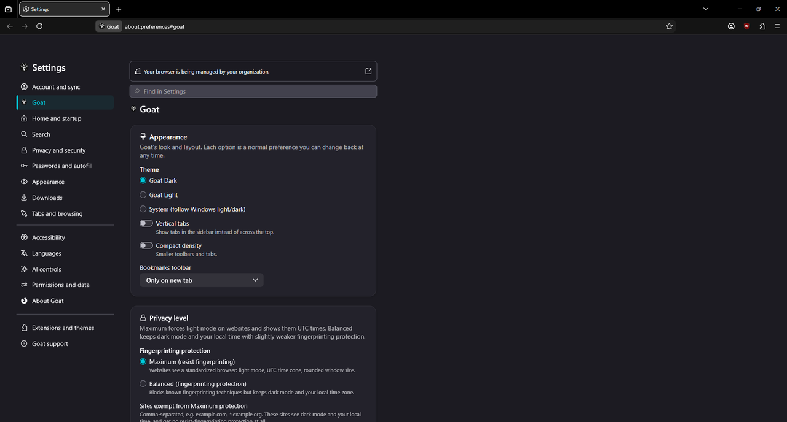
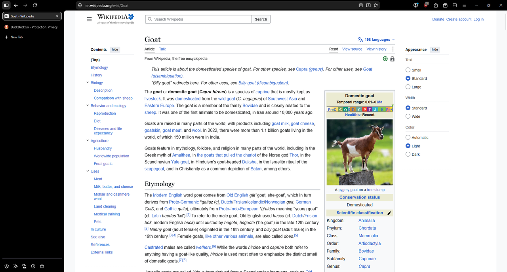

# Goat Browser

Goat Browser is a privacy-, security- and customization-focused web browser
built as a fork of **Firefox ESR**. The current base is Firefox
**153.5.1esr** (see [`ESR_VERSION`](ESR_VERSION)).

> Status: step 4. Goat branding, privacy defaults, policies, a bundled uBlock
> Origin, Goat themes and a Goat settings pane are applied on top of upstream
> Firefox ESR. There's a Windows installer and a routine for updating to new
> ESR releases.





## Layout

```
goat/
├── engine/                upstream Firefox ESR source (local checkout, NOT committed)
├── branding/
│   ├── GOAT.png           original logo
│   ├── goat-logo.png      transparent, square-cropped logo (generated)
│   └── goat/              branding dir -> engine/browser/branding/goat
│       ├── pref/firefox-branding.js   built-in privacy defaults
│       ├── content/goat-settings.mjs  the Goat settings pane
│       ├── content/themes/            Goat Dark and Goat Light themes
│       └── locales/en-US/goat.ftl     Goat UI strings
├── settings/
│   ├── policies.json      enterprise policies -> dist/bin/distribution/
│   ├── distribution/extensions/uBlock0@raymondhill.net.xpi   signed, from AMO
│   └── moz.build          installs the two above during the build
├── patches/               source patches against engine/ (git-apply format)
├── scripts/
│   ├── apply.sh           stages the overlay onto engine/ and sets MOZCONFIG
│   ├── make_branding.py   regenerates all branding images from GOAT.png
│   └── setup.md           toolchain versions used
├── docs/screenshots/      screenshots used in this README
├── mozconfig              build options
├── ESR_VERSION            exact upstream version, tag and commit we build on
└── LICENSE                MPL-2.0
```

`engine/` is a plain checkout of upstream Firefox at the tag in `ESR_VERSION`,
and it is gitignored. All Goat changes live in this repo and are copied or
applied onto `engine/` by `scripts/apply.sh`, which is safe to rerun.

### What Goat changes

- **Branding**: name "Goat" / "Goat Browser", vendor "Goat", executable
  `goat.exe`, and the goat logo for every icon, the About dialog and the
  installer bitmaps. Private-browsing icons use an inverted logo.
- **Build options** (`mozconfig`): updater, crash reporter and default-browser
  agent disabled; release build on the `esr` update channel; optimized and
  non-debug.
- **Privacy defaults** (`branding/goat/pref/firefox-branding.js`): strict
  Enhanced Tracking Protection, `privacy.resistFingerprinting`, HTTPS-Only
  Mode, telemetry, data reporting and studies off, sponsored content,
  Firefox Suggest, the new-tab weather widget, add-on recommendations and
  discovery off, no default-browser prompt. These are ordinary defaults, so users can change them in
  `about:config`.
- **Policies** (`settings/policies.json`): DisableTelemetry,
  DisableFirefoxStudies, DisablePocket, DuckDuckGo as the default search
  engine, uBlock Origin installed as `normal_installed` (the user can
  disable it, but it is reinstalled if removed), and UserMessaging to hide
  the Firefox Labs and More from Mozilla settings pages.
- **Goat settings pane** (`about:preferences#goat`): every control is bound
  to a real pref, so everything is reversible in `about:config`.
  - Appearance: theme (Goat Dark, Goat Light, or follow Windows), vertical
    tabs, compact density, bookmarks toolbar.
  - Privacy level: *Maximum* (`privacy.resistFingerprinting`, which forces
    light mode and UTC times on websites) or *Balanced* (RFP off and
    Firefox's fingerprinting protection, on via strict ETP, which keeps dark
    mode and local time). Under Maximum, a list of exempt sites
    (`privacy.resistFingerprinting.exemptedDomains`).
  - Privacy: HTTPS-Only Mode, clear cookies and site data on close (same
    semantics as Firefox's own checkbox; history is not cleared), and a button
    for the uBlock Origin dashboard.
  - Keyboard shortcuts: a link to Firefox's built-in editor, `about:keyboard`.
- **Themes**: Goat Dark (the default on new profiles) and Goat Light are
  built-in themes and appear in Add-ons → Themes.
- **About dialog**: Goat's own text and project link instead of Mozilla's
  donate and get-involved links, with credit to Firefox ESR by Mozilla.
- **Patches** (`patches/`):
  - `0001-set-app-vendor-goat.patch`: sets the build vendor to "Goat" (this
    ESR doesn't allow it in a mozconfig). The Firefox app ID is kept, so
    add-ons from addons.mozilla.org remain compatible.
  - `0002-honour-default-etp-category.patch`: makes a built-in default
    tracking-protection category ("strict") take effect on new profiles.
    Upstream recalculates the category from its sub-prefs, so a plain default
    would be ignored. Users can still switch to Standard or Custom.
  - `0003-windows-company-name-goat.patch`: "Goat" instead of "Mozilla
    Corporation" in the Windows file properties of goat.exe.
  - `0004-about-dialog-goat-credit.patch`: the About dialog text above.
  - `0005-goat-settings-pane.patch`: registers the Goat settings pane and
    its nav entry. The pane's code and strings live in `branding/goat`.
  - `0006-goat-builtin-themes.patch`: registers Goat Dark and Goat Light as
    built-in themes and switches new profiles to Goat Dark once. After that,
    the user's theme choice is left alone.
  - `0007-installer-goat-links.patch`: publisher "Goat" in Apps &
    features, and the uninstaller's feedback checkbox opens a GitHub issue
    instead of Mozilla's survey.
  - `0008-package-distribution-dir.patch`: always packages `distribution/`
    (policies and uBlock Origin).

### Known leftovers

- The profile folder is `%APPDATA%\Goat\Firefox`. Changing the internal app
  basename (`--with-app-basename=Goat`) would also change the user-agent to
  "Goat/…" unless more configure options were patched. That breaks
  addons.mozilla.org installs and makes users more fingerprintable, and it
  needs a near-full rebuild, so it is left as is.
- The About dialog's "Terms of Use" and "Privacy Notice" links still point
  to Mozilla's Firefox documents.

## Building on Windows

These are the steps used on the first machine (Windows 11, i7-12700H, 16 GB RAM).

1. **Install MozillaBuild** to `C:\mozilla-build` from
   <https://ftp.mozilla.org/pub/mozilla/libraries/win32/MozillaBuildSetup-Latest.exe>.
   Visual Studio is *not* needed: `mach bootstrap` downloads clang-cl, the
   MSVC libraries and the Windows SDK itself.
2. **Enable long paths in git**: `git config --global core.longpaths true`
3. **Clone this repo** to a path with no spaces, e.g. `C:\goat`.
4. **Fetch the engine** at the tag listed in `ESR_VERSION` (shallow clone):

   ```bash
   git clone --depth 1 --branch FIREFOX_153_5_1esr_RELEASE \
       https://github.com/mozilla-firefox/firefox C:/goat/engine
   ```

5. **Open the MozillaBuild shell** (`C:\mozilla-build\start-shell.bat`) and run:

   ```bash
   cd /c/goat/engine
   ./mach --no-interactive bootstrap --application-choice browser   # first time only
   cd /c/goat
   source scripts/apply.sh          # stage the overlay, export MOZCONFIG
   cd engine
   ./mach build
   ./mach run --temp-profile
   ```

   Always `source scripts/apply.sh` in a new shell before building, so that
   `MOZCONFIG` points at `C:\goat\mozconfig`.

On the first machine, bootstrap took about 12 minutes and the first
unmodified build took about 69 minutes (4155 s). The first Goat build is
listed in `scripts/setup.md`. Windows Defender was left at its defaults; adding
Defender exclusions for `C:\goat`, `C:\mozilla-build` and
`%USERPROFILE%\.mozbuild` should make builds faster.

The build output is `engine/obj-x86_64-pc-windows-msvc/dist/bin/goat.exe`.

### Regenerating the branding images

If `branding/GOAT.png` changes:

```bash
python -m venv .venv-tools
.venv-tools/Scripts/python -m pip install Pillow
.venv-tools/Scripts/python scripts/make_branding.py
```

### Updating uBlock Origin

Download the latest signed `.xpi` from addons.mozilla.org
(<https://addons.mozilla.org/firefox/addon/ublock-origin/>), replace
`settings/distribution/extensions/uBlock0@raymondhill.net.xpi`, and check its
SHA-256 against the hash published by the AMO API. The policy's `install_url`
also points at AMO's latest version, so a removed copy is reinstalled online.

### Packaging and the Windows installer

```bash
cd /c/goat && source scripts/apply.sh
cd engine
./mach package
```

`./mach package` builds both the zip and the full NSIS installer (NSIS ships
with MozillaBuild):

- `engine/obj-x86_64-pc-windows-msvc/dist/goat-<ver>.en-US.win64.installer.exe`
- `engine/obj-x86_64-pc-windows-msvc/dist/goat-<ver>.en-US.win64.zip`

`policies.json` and the bundled uBlock Origin `.xpi` are installed by the
build into `dist/bin/distribution/`. Upstream only packages that folder for
Mozilla's own builds, so `patches/0008` ships it unconditionally. Check
each new package:

```bash
~/.mozbuild/7zz/7zz.exe l dist/goat-*.installer.exe | grep -E 'distribution|\.exe$'
```

It should list `core\distribution\policies.json` and
`core\distribution\extensions\uBlock0@raymondhill.net.xpi`, plus `goat.exe`,
and no `firefox.exe`, `updater.exe`, `crashreporter.exe` or maintenance
service. (`pingsender.exe` is included but only runs when telemetry sends a
ping, and telemetry is off.)

## Installing

Run `Goat-Browser-Setup-<version>.exe` and click **Yes** on the Windows
permission (UAC) prompt. Goat installs to `C:\Program Files\Goat Browser`,
adds "Goat" and "Goat Private Browsing" Start Menu entries, and registers as
a browser in Windows Settings → Default apps. It does **not** make itself
the default browser. If you decline the UAC prompt, the installer falls back
to a per-user install in `%LOCALAPPDATA%\Goat Browser`. In Settings → Apps
it is listed as "Goat Browser ESR (x64 en-US)", publisher "Goat".

Uninstall from Windows Settings → Apps → Installed apps. Profiles
(`%APPDATA%\Goat`) are kept, as with Firefox.

Tested on Windows 11 (153.5.1esr): Program Files install, Start Menu launch
with a fresh profile (policies, Goat Dark, uBlock Origin, strict ETP,
HTTPS-Only, RFP and telemetry off all as expected), Default apps listing,
and a clean uninstall (files, Start Menu entries and uninstall entry
removed).

> Testing note: run installers from Explorer, not from inside a packaged
> (MSIX) app such as an AI assistant's shell. Windows silently redirects
> such an app's AppData and registry writes into its private container, so
> the install looks successful but isn't visible to Windows.

### SmartScreen (unsigned installer)

The installer is **not code-signed** yet. When it has been downloaded from
the internet, Windows SmartScreen shows "Windows protected your PC". Click
**More info** → **Run anyway**. The UAC prompt then shows the publisher as
"Unknown". Check the installer's SHA-256 against the one published with the
release before running it:

```powershell
Get-FileHash .\Goat-Browser-Setup-<version>.exe -Algorithm SHA256
```

A code-signing certificate would remove both warnings. Signing is a separate
decision, so it isn't set up.

## Updating to a new Firefox ESR

Mozilla ships an ESR **point release** (security fixes) about every 4 weeks,
and a new **major ESR** roughly once a year. Goat has **no auto-updater**
(`--disable-updater`), so users update by installing the new installer over
the old one. Their profile is kept.

1. **Check**: `scripts/check-esr.sh` prints whether a newer ESR exists.
   A weekly GitHub Actions workflow (`.github/workflows/esr-check.yml`) runs
   the same check and opens an issue titled "New Firefox ESR available:
   <ver>" if there isn't one already. It never builds anything.
2. **Update the source** (MozillaBuild shell):

   ```bash
   cd /c/goat
   scripts/update-esr.sh 153.6.0esr
   ```

   This reverts Goat's patches, shallow-fetches the
   `FIREFOX_<ver>esr_RELEASE` tag into `engine/`, dry-runs every patch with
   `git apply --check` (and stops with a list of conflicting patches if any
   fail), re-applies the overlay and updates `ESR_VERSION`.
3. **Build and package**: `source scripts/apply.sh`, then `cd engine`,
   `./mach build` and `./mach package`. For a point release an incremental
   build is enough; for a new major ESR run `./mach clobber` first and expect
   to rework some patches.
4. **Test** the installer (install, launch, check `about:policies`, the Goat
   settings pane, uBlock Origin, uninstall), then commit `ESR_VERSION` and
   any reworked patches.

## License

Goat Browser is licensed under the [Mozilla Public License 2.0](LICENSE), the
same license as the Firefox source it is based on. uBlock Origin is GPLv3 and
is redistributed unmodified. "Firefox" is a Mozilla trademark, and Goat
Browser is not affiliated with or endorsed by Mozilla.
